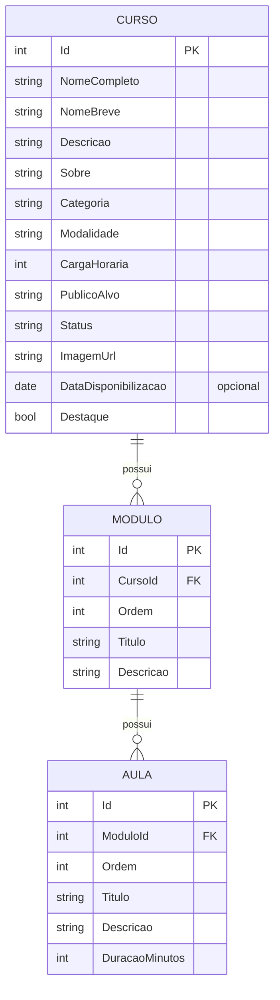

# Catálogo de cursos SESI+INDÚSTRIA

Aplicação web para consultar, pesquisar e filtrar um catálogo de cursos de um ambiente educacional (Moodle), desenvolvida como atividade prática do processo seletivo Desenvolvedor de Sistemas I (CTED).

- Aplicação publicada: https://catalogo-cursos-q297.onrender.com
- Repositório: https://github.com/caiocastelhano/catalogo-cursos
- Documentos complementares: [limitações e diferenças em relação ao Figma](docs/LIMITACOES_E_DIFERENCAS.md) · [uso de IA](USO_DE_IA.md)

> O plano gratuito do Render coloca o serviço em repouso após cerca de 15 minutos sem acesso. A primeira requisição depois disso pode levar cerca de um minuto.

## 1. Objetivo

Permitir que o usuário liste cursos pela API, pesquise por nome, filtre por categoria, modalidade e status (combinando busca e filtros), veja a quantidade de resultados, limpe os filtros e abra os detalhes de cada curso. O front-end segue o protótipo do Figma fornecido. Todos os dados são fictícios.

Páginas:

| Rota | Conteúdo |
|---|---|
| `/` | Home: hero, principais cursos, impacto, depoimentos e chamada final |
| `/cursos` | Catálogo com busca, filtros, contador e estados de carregamento, erro e vazio |
| `/cursos/:id` | Detalhes do curso, com módulos, aulas e avaliações e dúvidas frequentes |
| `/cursos/:id/aula` | Sala de aula de demonstração |

## 2. Tecnologias

| Camada | Tecnologia |
|---|---|
| Back-end | C#, .NET 8, ASP.NET Core Minimal API |
| Acesso a dados | Entity Framework Core 8 (migrations) |
| Banco de dados | SQLite (código aberto) |
| Documentação da API | Swagger (Swashbuckle) |
| Front-end | React 19, Vite 6, React Router 7, CSS puro |
| Fonte | Open Sans (`@fontsource-variable/open-sans`) |
| Publicação | Docker (build em 3 etapas) no Render, plano gratuito |

## 3. Arquitetura

Um único deploy: o .NET serve a API em `/api` e o front-end compilado em `wwwroot`.

```
Navegador
   │  HTTPS
   ▼
Kestrel (.NET 8)
   ├── /api/*          Minimal API ──► EF Core ──► SQLite (catalogo.db)
   ├── /assets, /img   arquivos estáticos (wwwroot), com cache e compressão
   └── demais rotas    index.html (o React Router resolve a página)
```

Em desenvolvimento, o Vite serve o front em `http://localhost:5173` e repassa `/api` para a API em `http://localhost:5257` (proxy), sem necessidade de CORS.

## 4. Estrutura de pastas

```
catalogo-cursos/
├── backend/CatalogoCursos/
│   ├── Data/            AppDbContext e DbSeeder (dados fictícios)
│   ├── Dtos/            objetos de resposta da API
│   ├── Models/          Curso, Modulo, Aula
│   ├── Migrations/      migrations do EF Core
│   ├── Utils/           normalização de texto para a busca
│   ├── wwwroot/         front compilado (gerado no build; fora do Git)
│   └── Program.cs       configuração e endpoints
├── frontend/
│   ├── public/          imagens otimizadas (.webp) e ícones (.svg)
│   └── src/
│       ├── api/         cliente da API
│       ├── components/  cabeçalho, rodapé, cards, carrossel, acordeão etc.
│       ├── data/        textos estáticos (depoimentos, benefícios, dúvidas)
│       ├── hooks/       useApi, useTitulo
│       ├── pages/       Home, Cursos, CursoDetalhe, SalaAula
│       ├── styles/      tokens de design e estilos globais
│       └── utils/       formatação e normalização
├── scripts/             build, verificação e geração do ZIP
├── docs/                limitações e diferenças em relação ao Figma
├── Dockerfile
├── README.md
└── USO_DE_IA.md
```

## 5. Instruções para execução

Requisitos: .NET SDK 8, Node.js 20 ou superior e bash (para os scripts).

### Desenvolvimento (dois terminais)

```bash
git clone https://github.com/caiocastelhano/catalogo-cursos.git
cd catalogo-cursos

# Terminal 1: API em http://localhost:5257 (Swagger em /swagger)
cd backend/CatalogoCursos
dotnet run

# Terminal 2: front-end em http://localhost:5173
cd frontend
npm install
npm run dev
```

### Simulação da produção (um único servidor)

```bash
bash scripts/testar-publicacao.sh
```

O script compila o front, copia para `wwwroot`, publica o .NET, sobe o servidor na porta 8099 e executa `scripts/verificar.sh`. Para abrir no navegador:

```bash
cd /tmp/publish-teste && PORT=8099 dotnet CatalogoCursos.dll
```

### Com Docker

```bash
docker build -t catalogo-cursos .
docker run --rm -p 8080:8080 -e PORT=8080 catalogo-cursos
```

Acesse `http://localhost:8080`. O Dockerfile foi validado pelo build da hospedagem e pela simulação acima; não foi executado localmente com Docker.

## 6. Configuração do banco

- Banco: SQLite, arquivo `catalogo.db` criado no diretório de execução.
- Conexão: `ConnectionStrings:Default`, com padrão `Data Source=catalogo.db`. Pode ser alterada pela variável de ambiente `ConnectionStrings__Default`.
- Na inicialização, a aplicação aplica as migrations (`Database.Migrate()`) e popula os dados fictícios (`DbSeeder`) se a tabela de cursos estiver vazia.
- Nenhuma configuração manual é necessária.
- Para recriar o banco do zero, apague `catalogo.db` e reinicie.
- Nova migration (a partir de `backend/CatalogoCursos`): `dotnet ef migrations add NomeDaMigration`.

Dados do seed: 8 cursos, 3 categorias (Matemática, Ciências da Natureza e Linguagens), 2 modalidades (Presencial e Online) e 3 status (Inscrições abertas, Em andamento e Encerrado), com cargas horárias, módulos, aulas e públicos-alvo diferentes.

## 7. Endpoints

| Método | Rota | Descrição |
|---|---|---|
| GET | `/api/cursos` | Lista cursos, com filtros opcionais |
| GET | `/api/cursos/{id}` | Detalhe do curso, com módulos e aulas |
| GET | `/api/filtros` | Valores disponíveis de categoria, modalidade e status |
| GET | `/healthz` | Verificação de saúde |
| GET | `/swagger` | Documentação interativa |

Parâmetros de `GET /api/cursos` (todos opcionais e combináveis):

| Parâmetro | Efeito |
|---|---|
| `busca` | Nome completo ou breve contém o texto (sem diferenciar acentos nem maiúsculas) |
| `categoria` | Igual à categoria |
| `modalidade` | Igual à modalidade |
| `status` | Igual ao status |

Resposta de `GET /api/cursos?categoria=Linguagens`:

```json
{
  "total": 2,
  "itens": [
    {
      "id": 7,
      "nomeCompleto": "Comunicação Técnica e Leitura de Manuais na Indústria",
      "nomeBreve": "Comunicação Técnica",
      "descricao": "...",
      "categoria": "Linguagens",
      "modalidade": "Online",
      "cargaHoraria": 20,
      "publicoAlvo": "...",
      "status": "Em andamento",
      "imagemUrl": "/img/curso-7.webp",
      "dataDisponibilizacao": "2026-09-14",
      "destaque": false
    }
  ]
}
```

Erros: `GET /api/cursos/99` devolve 404 no formato Problem Details (`title`, `status`, `detail`). Rotas inexistentes sob `/api` devolvem 404, sem cair no front-end.

## 8. Modelo de dados



Categoria, modalidade e status são texto, com índice. Como o catálogo é somente leitura e os valores são poucos, tabelas separadas não trariam ganho; a lista de valores válidos vem de `GET /api/filtros`.

## 9. Estratégia de responsividade

- Layout fluido com CSS Grid e Flexbox, contêiner de até 1200 px e margens laterais de 24 px.
- Pontos de quebra em 960, 860, 800 e 560 px. Exemplos: os filtros passam de 5 colunas para 2 e depois para 1; hero, "Sobre o curso" e chamada final passam para uma coluna; na sala de aula, a barra lateral vira um bloco acima do conteúdo.
- Tipografia com `clamp()` nos títulos.
- Grade do catálogo com `repeat(auto-fill, minmax(260px, 1fr))`, sem quebras fixas.
- Imagens com `aspect-ratio` e `object-fit: cover`, o que evita deslocamento de layout.
- Carrosséis com `scroll-snap` e rolagem por toque, além de botões.
- O Figma fornecido tem apenas a versão desktop; o comportamento em telas menores foi definido neste projeto.

## 10. Decisões de acessibilidade

- Idioma da página (`pt-BR`), título por rota e hierarquia de títulos coerente (um `h1` por página).
- Marcos semânticos: `header`, `nav` com rótulo, `main`, `aside`, `footer`; link "Ir para o conteúdo" no início.
- Todos os campos com `label`; busca em `form` com `role="search"`.
- Contagem de resultados em região `aria-live`; carregamento com `role="status"` e erro com `role="alert"`, com botão "Tentar novamente".
- Foco visível em todos os elementos interativos e navegação completa por teclado.
- Acordeões com `<details>` e `<summary>` nativos; carrosséis com `aria-roledescription`, botões rotulados e trilho focável.
- Cards inteiros clicáveis por um único link (o título); imagens decorativas com `alt` vazio e imagens informativas com texto alternativo.
- Situação do curso, da aula e da avaliação sempre em texto, nunca só por cor.
- Alvos de toque de pelo menos 44 px nos controles principais e respeito a `prefers-reduced-motion`.
- Medições (Lighthouse e axe): a registrar neste documento após a revisão final.

## 11. Processo de publicação

1. O repositório está no GitHub (branch `main`).
2. No Render, serviço Web com runtime Docker, plano gratuito, região Frankfurt, usando o `Dockerfile` da raiz.
3. A variável `PORT` é definida pelo Render e lida pela aplicação.
4. Cada `git push` na `main` dispara um novo build:
   - etapa 1: Node compila o front (`npm ci` e `npm run build`);
   - etapa 2: o SDK do .NET publica a API, com o front em `wwwroot`;
   - etapa 3: imagem final apenas com o runtime do ASP.NET.
5. Verificação do publicado: `bash scripts/verificar.sh https://catalogo-cursos-q297.onrender.com`.
6. Pacote para entrega: `bash scripts/gerar-zip-publicacao.sh` gera `catalogo-cursos-publicacao.zip` com a aplicação compilada e o código versionado.

## 12. Limitações conhecidas

Resumo; a lista completa e as diferenças em relação ao Figma, com justificativas, estão em [docs/LIMITACOES_E_DIFERENCAS.md](docs/LIMITACOES_E_DIFERENCAS.md).

- Hospedagem gratuita com repouso após inatividade; a primeira requisição pode demorar cerca de um minuto.
- O SQLite fica dentro do contêiner e é recriado a cada reinício, o que é aceitável para um catálogo somente leitura.
- Não há cadastro, edição ou exclusão de cursos, nem matrícula, autenticação ou integração com Moodle (diferencial não realizado).
- A sala de aula é uma demonstração: o progresso é calculado a partir da aula selecionada, e o vídeo não possui reprodução.
- Não há testes automatizados; a validação foi manual e por `scripts/verificar.sh`.
- Valores de design que o protótipo não permite medir (tamanhos, espaçamentos, raios e sombras) foram estimados.